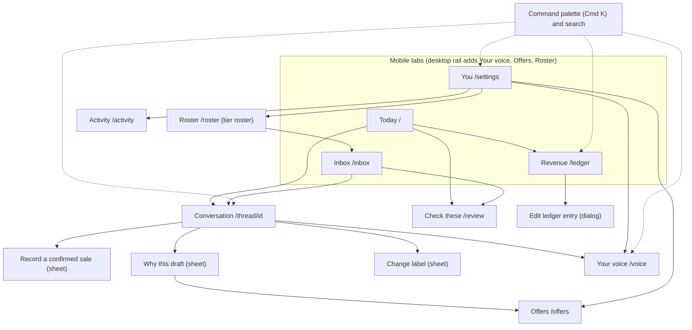
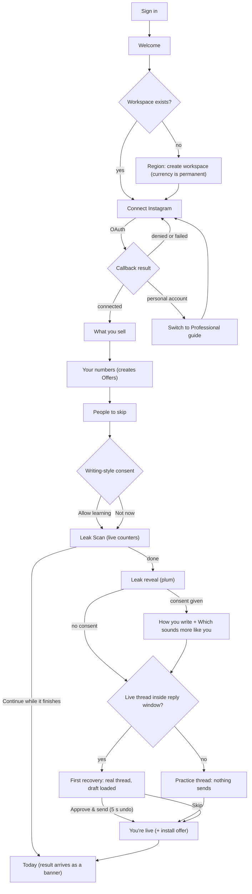
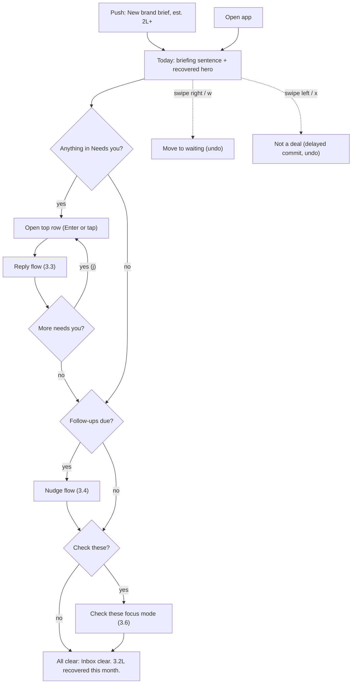
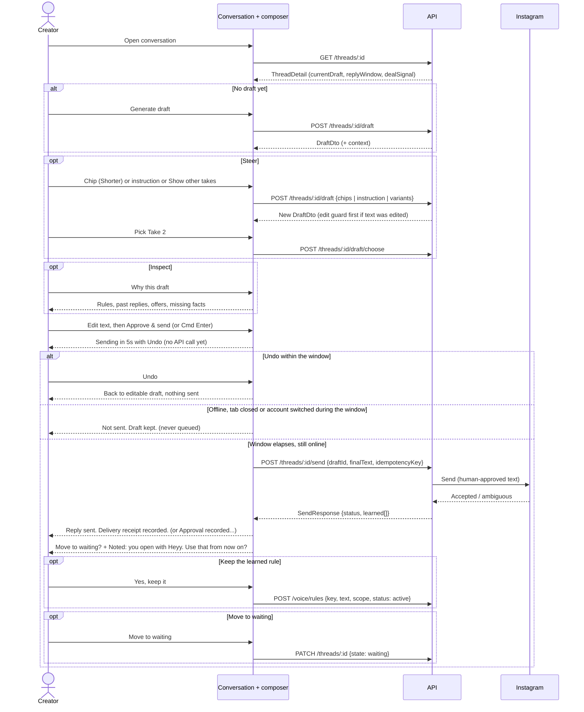
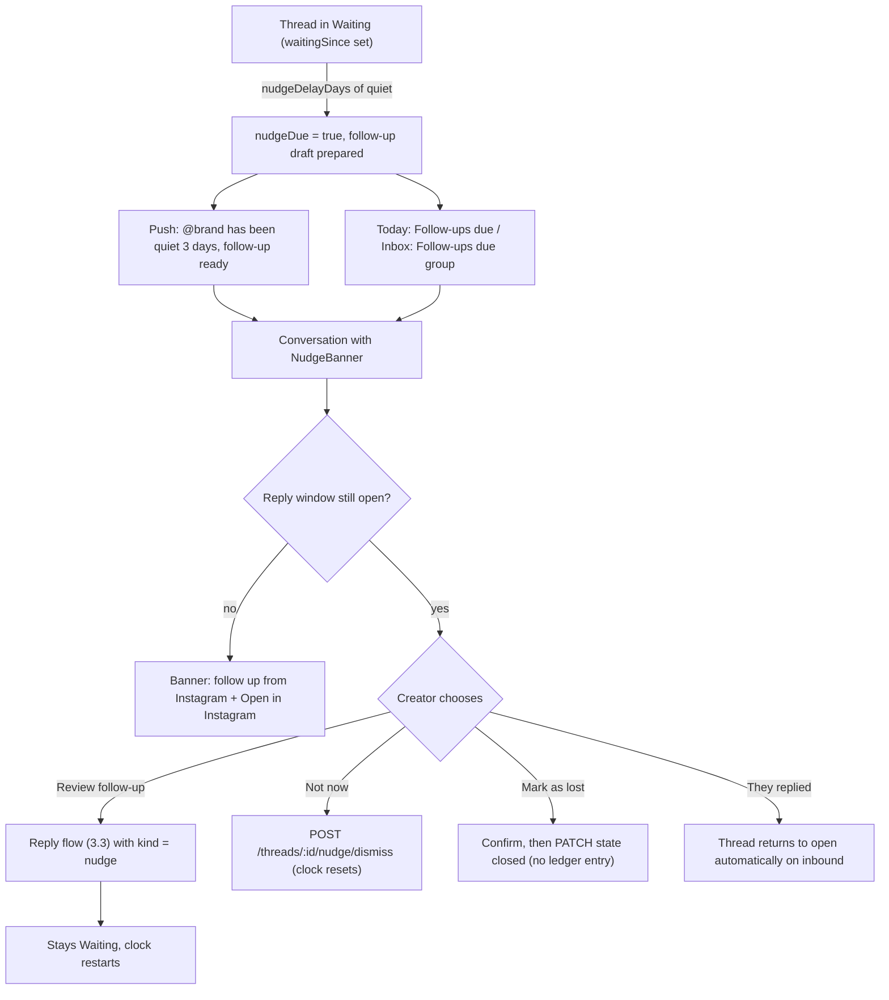
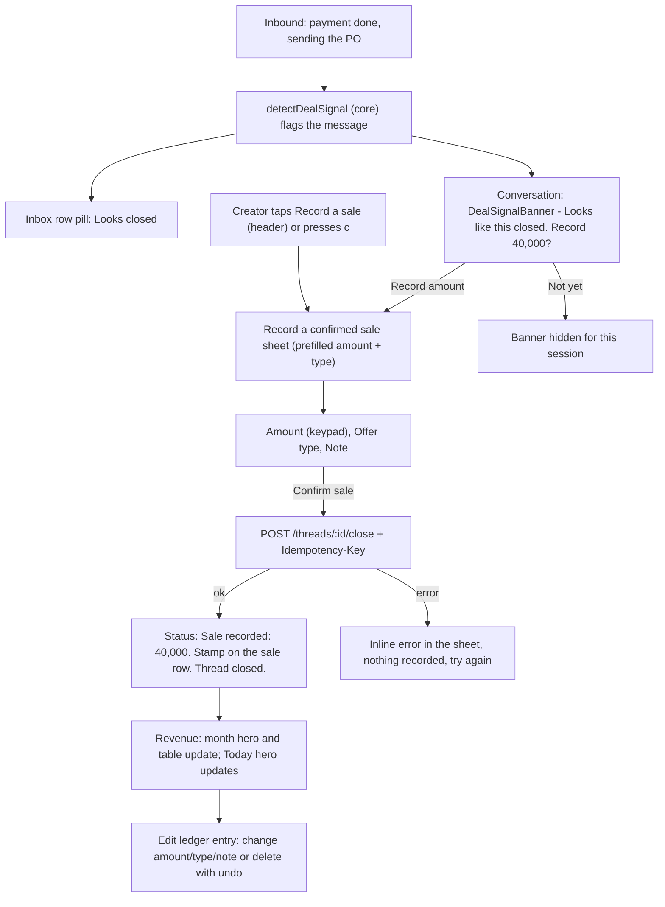
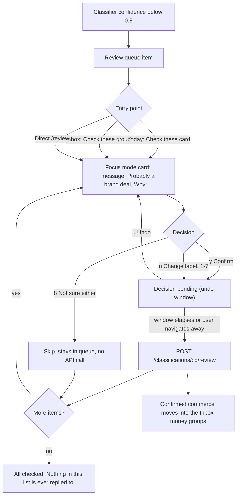
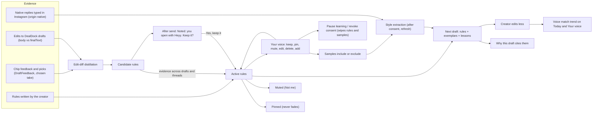
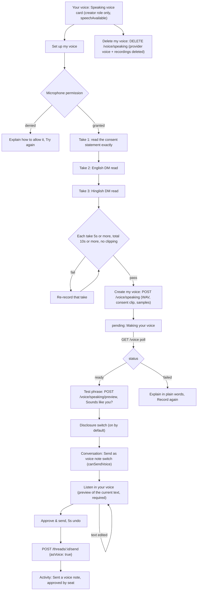
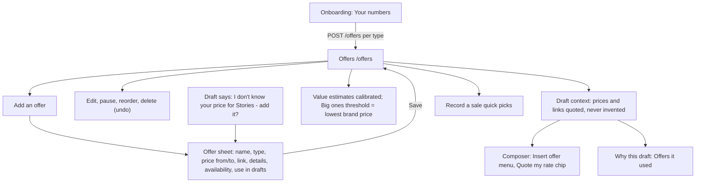

# 01 — Screens and flows (redesign, 31 Oct 2026)

Companion to `DESIGN.md` v2 (visual system, components, per-screen specs and copy) and `docs/redesign/00-decisions.md` (build contract). This file is the map: what screens exist, how people move between them, and why the big choices went the way they did. When this file and `DESIGN.md` disagree, `DESIGN.md` wins and this file gets fixed.

---

## 1. Screen inventory

APIs refer to `00-decisions.md` §4 and `packages/core/src/api-types.ts`; v1 endpoints are described in `docs/research/05b-backend-inventory.md`.

| ID | Route | Screen | Purpose | Primary action | Data source | DESIGN.md |
|---|---|---|---|---|---|---|
| S0 | `/sign-in/[[...sign-in]]` | Sign-in / accept invite | Get a pilot member into their workspace | Sign in (Clerk) | Clerk; `POST /seats/activate` | §5.1 |
| O0 | `/onboarding` | Welcome | One promise, time estimate, trust line | **Let's start** | — | §5.2 |
| O1 | `/onboarding?step=region` | Region / create workspace | Permanent currency, number format, time zone with live preview | **Create workspace** / **Continue** | `POST /organizations/bootstrap`, `PUT /settings/region` | §5.2 |
| O2 | `/onboarding?step=connect` | Connect Instagram | Explain, then OAuth; restore on return | **Connect Instagram** | `POST /ig/connect`, `GET /onboarding` (`?connected=`) | §5.2 |
| O2b | `/onboarding?step=connect&error=personal_account` | Switch to Professional | 2-minute guide and retry | **Try again** | — | §5.2 |
| O3 | `/onboarding?step=sell` | What you sell | Multi-select that branches the next step | **Continue** | held for `PUT /onboarding` | §5.2 |
| O4 | `/onboarding?step=numbers` | Your numbers / offers | Price ranges that seed estimates and Offers | **Continue** | `POST /offers`, `PUT /onboarding` | §5.2 |
| O5 | `/onboarding?step=skip` | People to skip | Ignore list | **Continue** | `PUT /onboarding` (`ignoreHandles`) | §5.2 |
| O6 | `/onboarding?step=consent` | Writing-style consent | Plain-language, un-pre-ticked consent | **Allow learning** | `PUT /onboarding` (`voiceConsent`) | §5.2 |
| O7 | `/onboarding?step=scan` | Leak Scan (live) | Real counters + dot constellation | (auto) / **Continue while it finishes** | `POST`/`GET /onboarding/leak-scan` | §5.2 |
| O8 | `/onboarding?step=leak` | Leak reveal (plum) | Conservative headline + top 3 missed | **See how you write** / **Recover your biggest one** | `GET /onboarding/leak-scan` | §5.2 |
| O9 | `/onboarding?step=voice` | How you write + calibration | Style traits with cited samples; 2-option picks | **Continue** | `GET /voice`, `POST /voice/preview`, `PUT /voice/style` | §5.2 |
| O10 | `/onboarding?step=recover` | First recovery | Send one real reply (or practice) | **Approve & send** | `GET /inbox`, `GET /threads/:id`, `POST /threads/:id/send` | §5.2 |
| O11 | `/onboarding?step=live` | You're live | Recap, plan timing, install offer | **Go to Today** | `GET /billing` | §5.2 |
| T1 | `/` | Today | Briefing + recovered hero + what needs you | Open the top "Needs you" row | `GET /insights?months=6`, `GET /inbox?state=open`, `GET /inbox?state=waiting`, `GET /review-queue` | §5.3 |
| I1 | `/inbox` | Revenue Inbox | Grouped by money and state; filters; search; split pane | Open a conversation | `GET /inbox?state&label&q&limit&cursor`, `GET /review-queue`, `GET /offers` | §5.4 |
| I2 | `/thread/[id]` | Conversation | Read, reply in your voice, record the sale | **Approve & send** | `GET /threads/:id`; draft/choose/feedback/send/close/PATCH/nudge-dismiss; `POST /voice/speaking/preview`; `POST /voice/rules` | §5.5 |
| I3 | (sheet in I2) | Why this draft | Rules, past replies, offers, lessons, missing facts | **Add to offers** (when facts missing) | `DraftDto.context` | §3.6 |
| I4 | (sheet in I2) | Record a confirmed sale | Keypad amount, offer type, note | **Confirm sale** | `POST /threads/:id/close` | §3.6 |
| I5 | (sheet in I2) | Change label / Not a deal | Correct the classification | **Save** | `POST /classifications/:id/review` | §5.5 |
| R1 | `/review` | Check these (focus mode) | Confirm or correct uncertain classifications | **Confirm: {label}** (`y`) | `GET /review-queue`, `POST /classifications/:id/review` | §5.6 |
| L1 | `/ledger` | Revenue Ledger | Month hero, trend, by type, goal, top sales, entries, recap | **Export CSV** / **Edit** | `GET /ledger?month`, `GET /insights`, `PATCH`/`DELETE /ledger/:id`, `GET /ledger/export.csv`, `PUT /settings/goal` | §5.7 |
| L2 | (dialog in L1) | Edit ledger entry | Fix amount/type/note, delete with undo | **Save** | `PATCH /ledger/:id`, `DELETE /ledger/:id` | §5.7 |
| V1 | `/voice` | Your voice | Voice match, style card, learned rules, samples, playground, speaking voice, consent | **Try it** | `GET /voice` + the `/voice/*` writes, `PUT /settings/voice/consent` | §5.8 |
| F1 | `/offers` | Offers | Private rate card used by drafts and estimates | **Add an offer** | `GET/POST /offers`, `PATCH/DELETE /offers/:id` | §5.9 |
| Y1 | `/settings` | You / Settings | Profile & appearance, Instagram, region, goal, notifications, skip list, team, billing, activity, your data, danger zone | per section | `GET /settings`, `/notifications/prefs`, `/billing`, `/settings/ignore-list`, `/seats`, `/audit?limit=10`, `/settings/data`, `/me` + writes | §5.10 |
| A1 | `/activity` | Activity | Who sent what; draft vs sent | Expand a row | `GET /audit?limit=100` | §5.12 |
| RO1 | `/roster` | Roster (tier roster) | Every creator account at a glance | **Open inbox** | `GET /roster` | §5.11 |
| K1 | (global dialog) | Command palette | Jump to conversations, actions, settings | Enter | `GET /inbox?q=` + static actions | §4.3 |
| X1 | `not-found.tsx` | 404 | Recover | **Go to Today** | — | §5.13 |
| X2 | `error.tsx` | Error boundary | Recover | **Reload** | — | §5.13 |
| X3 | `/offline.html` | Offline page | Explain, retry | **Try again** | — | §5.13 |
| X4 | (global) | Banners and sheets: offline, reconnect, read-only, push prompt, install, demo label, session expired, workspace setup | Keep people unstuck | one action each | `GET /settings` (account status), `GET /billing` | §5.13 |

There is no `/insights` page (the `GET /insights` API feeds T1 and L1) and no `/dashboard` page (v1's `/` dashboard becomes Today).

---

## 2. Navigation map

Every core surface is ≤ 2 taps from Today: Today → row → conversation; Today → hero → Revenue; Today → "Check all" → Check these; Today → "See what DealDock learned" → Your voice.

---

## 3. Flows

### 3.1 Onboarding

Notes: steps live in `?step=` so OAuth returns and browser Back restore state. Push permission is **not** asked here (§3.4 of the inbox flow asks it in context). Tiny-leak and zero-business variants of the reveal are in DESIGN §5.2.

### 3.2 Daily triage loop

### 3.3 Reply and send, with undo and learning

Failure branches: `409 send_window_closed` → composer becomes the "Reply in Instagram" handoff; network/provider error → "Couldn't reach Instagram. Your reply wasn't sent." with **Try again** reusing the same idempotency key; `sendInFlight` → the "already approved, not sending again" state.

### 3.4 Follow-up nudge

### 3.5 Close-out (including deal signal)

### 3.6 Review (Check these)

No path in this flow leads to a draft or a send.

### 3.7 Voice studio learning loop

### 3.8 Speaking voice: creation and voice-note send

### 3.9 Offers

---

## 4. Options considered

### 4.1 Navigation model

| Option | For | Against |
|---|---|---|
| A. Keep v1 tabs Inbox · Review · Ledger · Settings | No migration | Settings is not a peer of the core job; Review as a tab makes classification look like a destination; no home briefing |
| **B. Today · Inbox · Revenue · You (chosen)** | Material's 3–5 equal destinations; a briefing home; Settings, Your voice and Offers collected under You on mobile; desktop rail adds Your voice and Offers because there is room | One more tap to reach Your voice on mobile (mitigated by Today's "See what DealDock learned" link and ⌘K) |
| C. Inbox-only home (triage is the home screen) | Fastest to the job | Loses the recovered-money hero, which is the retention mechanism; no place for follow-ups, rhythm and voice progress |

**Chosen: B.** It keeps money and triage one tap away, gives the north-star number a home, and stops Settings competing with the job (research 01 §5.4, anti-pattern 4).

### 4.2 Where Review lives

| Option | For | Against |
|---|---|---|
| A. Top-level tab | Impossible to miss | Turns a 30-second chore into a destination; a fifth tab |
| B. Only inside Inbox | Simple | Easy to forget; no focused keyboard flow |
| **C. "Check these" group in Inbox + card on Today + `/review` focus mode (chosen)** | Unmissable on the two screens people open; a fast focused flow when there are many; Copilot Money "To Review" precedent | Three entry points to keep consistent (they share one component) |

**Chosen: C** (decisions §1.4). `/review` keeps returning 200 for the browser gate.

### 4.3 Theme

| Option | For | Against |
|---|---|---|
| A. Dark-first "Afterhours" (evolve v1) | Continuity with v1; cinematic | Looks like every dark SaaS; weaker small-text legibility in daylight (NN/g); breaks continuity with the paper marketing brand |
| **B. Light-first "Paper & Highlighter" with a full dark twin (chosen)** | Brand-continuous; reads in sunlight; warm, calm, distinct from Stan/Beacons/Kajabi; one token set gives both themes | Can feel quiet; the money moments must be crafted (highlighter, stamp, plum peaks) |
| C. "Marigold Studio" expressive | Most creator-native | Least calm, dates fastest, link-in-bio feel, weaker trust for money |

**Chosen: B**, following the system setting with a manual override; C's plum hero is borrowed for exactly two peaks (leak reveal, monthly recap).

### 4.4 ⌘↵ to approve

| Option | For | Against |
|---|---|---|
| A. No key combination approves (workspace prototype) | Maximum deliberateness | Slows desktop power users and managers who triage all day |
| B. ⌘↵ sends immediately | Fastest | A mis-press sends to a brand with no recovery |
| **C. ⌘↵ approves only with the composer focused and a current non-empty draft, then the same 5 s client-side undo as a click (chosen)** | Speed plus a real escape hatch; approval is still an explicit human act on visible text; nothing reaches the API until the window ends | A 5 s delay before the API call; the e2e assertion needs a longer timeout |

**Chosen: C** (decisions §1.10). The undo window is adjustable (5/10/20 s) for accessibility.

### 4.5 Split pane vs push navigation

| Option | For | Against |
|---|---|---|
| A. Push navigation everywhere | One layout; simplest routing | Wastes desktop width; slower j/k triage; loses list context |
| B. Three panes always on desktop | Max context | Cramped at 1024–1279 px |
| **C. Split pane (list beside conversation) at ≥ 1024 px, deal-facts column added at ≥ 1280 px, push on mobile (chosen)** | Superhuman/Linear-style triage; list context stays; mobile stays focused | Needs a shared `(inbox)` route-group layout, `<Activity>` to keep edited drafts alive, and care so the list header is `h2` on conversation routes (one `h1`) |

**Chosen: C** (decisions §1.5).

### 4.6 Inbox grouping

| Option | For | Against |
|---|---|---|
| A. One flat list sorted by value (v1) | Simple | Waiting, follow-ups and uncertain items get lost; no sense of "the big ones" |
| B. Group by sender type (brand / coaching / course) | Mirrors labels | Splits attention by category instead of urgency; labels are already chips |
| **C. Group by money and state: Big ones · Everything else · Follow-ups due · Check these · Waiting · Closed (chosen)** | Answers "what's worth the most and what's blocked"; Superhuman Split Inbox shows 3–7 streams reduce load | Needs a threshold for "big" (lowest brand offer price, else a per-currency default) |

**Chosen: C** (decisions §1.5). Labels stay as filter chips; fans/personal/spam sit behind a footer link.

### 4.7 Streaks vs rhythm

| Option | For | Against |
|---|---|---|
| A. Daily streak with flames | Proven engagement mechanic | Anxiety debt, guilt pushes, gamification in a money tool (Robinhood precedent); punishes days off |
| B. No momentum signal | Calm | Loses a real business lever: brands pick creators who reply fast |
| **C. Weekly reply-speed rhythm that resets Monday + monthly recap (chosen)** | Measures the lever that matters (median first reply, % within 24h); no loss aversion; a month-end peak | Less "sticky" than a streak by design |

**Chosen: C** (decisions §1.9). No "don't lose your streak" pushes, ever.

### 4.8 Smaller decisions recorded here

| Decision | Options | Chosen and why |
|---|---|---|
| Onboarding order | Connect before Region (research 01) vs Region first | **Region first**: `POST /organizations/bootstrap` needs the permanent currency and `POST /ig/connect` needs a seat. The pre-OAuth explainer still precedes Connect. |
| Undo implementation | Server undo endpoints vs client-delayed commit | **Reverse call when the server can reverse; otherwise delay the API call.** Sends are cancelled (never queued) if the app closes or goes offline in the window; other actions flush on navigation. |
| Confidence words thresholds | Percentages vs words | **Words**: ≥ 0.80 "Looks like", 0.55–0.79 "Probably", < 0.55 "Not sure — maybe". |
| Classification label for `other_commerce` | "Commerce", "Other" | **"Other sale"** (plain English; "Commerce" is jargon). Deal type stays "Other". |
| Success colour | Reuse recovered green vs separate | **Separate teal `--dd-success`** so green stays "confirmed money" only. |
| Review keyboard `8` | Map to `uncertain` vs skip | **Skip** ("Not sure either") — overriding to "uncertain" is meaningless. |
| Calibration pick storage | Feedback endpoint vs style override | **`PUT /voice/style` overrides** (length; language mix) — no preview-feedback endpoint exists. |
| `/insights` page | Separate analytics page vs folded in | **Folded into Today and Revenue**; fewer destinations, no KPI wall. |

---

## 5. Contract gaps for the backend owners

These are places where the screens need something `api-types.ts` / 05b does not provide yet. Each screen spec degrades gracefully until it lands.

| # | Gap | Needed by | Proposed shape | Degraded behaviour until then |
|---|---|---|---|---|
| G1 | `GET /onboarding/leak-scan` has no status or progress | O7 Leak Scan | add `status: "running" \| "done"` and optional `totalMaxMinor` | treat as done when counts are unchanged for 3 polls (or 90 s); reveal shows only the low end |
| G2 | `GET /ig/callback` returns JSON on errors | O2 Connect | 302 to `${WEB_APP_URL}/onboarding?step=connect&error=<code>` for every failure | the creator lands on raw JSON (dead end) |
| G3 | `InboxRow` has no `igAccountId`; `GET /inbox` can't filter by account | Roster creator context, Inbox account chip | `igAccountId` on rows + `?igAccountId=` filter | Roster rows open the unfiltered inbox |
| G4 | Review-queue rows carry no `participant` or audio | R1 card sender context, voice-note items | add `participant: ParticipantProfile` and `audio: AudioAttachment \| null` | card shows the handle only; audio shows "Voice note — open the conversation to listen" |
| G5 | Relabel after a human decision ("first decision wins") | I5 Change label on an already-reviewed thread | allow a later human override (audited) or a thread-level relabel endpoint | Change label is hidden when the latest classification already has `reviewedAt` |
| G6 | No restore for soft-deleted ledger entries | L2 delete undo | `POST /ledger/:id/restore` | client-delayed commit (works, but can't undo after the window) |
| G7 | `Insights.topDeals` window unspecified | T1 Recent wins | document window (current month?) and sort | client filters to the current month, newest first |
| G8 | Audit `action` strings aren't enumerated | A1 Activity humanised copy | export an `AuditAction` union from core | unknown actions render in sentence case |
| G9 | Push high-value threshold ignores currency | Push prompt | per-currency threshold in core (same table as the Big-ones default) | prompt uses the web-side per-currency table |
