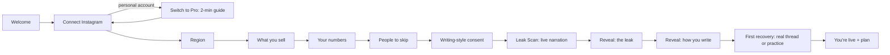
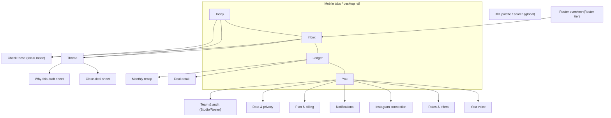

# 01 — Premium UX research: what makes DealDock feel worth paying for

31 October 2026 · Research input for the DealDock redesign · Scope: visual language, onboarding, dashboard, inbox/triage, mobile PWA, anti-patterns, information architecture, microcopy.

**How to read this.** Each section ends with concrete recommendations for DealDock. Sources are cited inline. Evidence quality varies, so claims are tagged where it matters:

- **[primary]**: the company's own docs, changelog, blog or a peer-reviewed paper.
- **[third-party]**: a reviewer, teardown or "DESIGN.md" token breakdown. Useful, but the tokens are reconstructions, not official specs.
- **[opinion]**: my design judgement, argued from the evidence.
- **[verified locally]**: checked in this repo, for example by parsing the bundled font files.

Repo context used: `DealDock_Product_PRD.md`, `DESIGN.md` (dark/gold spec, now superseded in spirit by the live paper-and-yellow marketing brand), `design/workspace/` (light "paper" prototype that matches dealdock.io: paper `#f3f4ef`, ink `#191d1b`, signal yellow `#f9d84a`), `design/studio/` (writing-style studio concept), `docs/voice-and-audio-audit.md`, and the sibling research docs `02-competitors-and-gaps.md` and `05a-frontend-inventory.md`.

---

## 0. The short version

1. **Premium is restraint plus speed plus a few crafted peaks.** It isn't decoration. Linear's 2026 refresh is explicitly about "not every element should carry equal visual weight" and dimmer navigation so content leads ([Linear, primary](https://linear.app/now/behind-the-latest-design-refresh)). Superhuman sells speed and spends its delight budget on one moment: Inbox Zero photography ([Superhuman, primary](https://new.superhuman.com/100+-new-inspiring-inbox-zero-photographs-324665)).
2. **Money must look like money.** Use a dedicated money type style, tabular figures, one colour that means "money", and a strict visual split between *estimated* and *confirmed* values. Mercury, Stripe and Copilot Money all treat numerals as a first-class typographic system ([Stripe Apps chart docs, primary](https://docs.stripe.com/stripe-apps/patterns/chart-layout); [Mercury breakdown, third-party](https://blakecrosley.com/guides/design/mercury)).
3. **Home should be a briefing, not a dashboard.** A sentence like "3 deals worth about ₹2.4L need you" beats a grid of KPI tiles. Use one hero number (Recovered), and treat everything else as a to-do.
4. **Onboarding has to *do* the job, not tour it.** Superhuman found checklists and tooltips had "zero measurable impact". Full-screen required steps and a practice inbox moved activation ([First Round Review, primary interview](https://review.firstround.com/superhuman-onboarding-playbook/)). For DealDock the climax is the Leak Scan reveal, then sending one real reply.
5. **AI drafts must show their working and visibly learn.** Competitors now market "drafts that sound like you": Beacons on 18 Oct 2026, and Superhuman Auto Drafts in July 2026, with two alternates and learning from the creator's picks ([Beacons, primary](https://beacons.ai/i/whats-new); [TechCrunch](https://techcrunch.com/2026/07/14/superhumans-new-auto-draft-feature-almost-makes-me-like-ai-replies/)). DealDock wins by making the learning *inspectable*: "Learned from your edits: you open with 'Heyy', never 'Hi'". It also has the DM and Hinglish context and the money proof.
6. **Recommended visual direction: "Paper & Highlighter".** It is light-first with a true dark twin, evolves the live brand, and uses a yellow highlighter for money that needs action and deep green for money recovered. Geist Sans, Geist Mono and Geist Serif are all OFL and already in the family. The details are in §4.

---

## 1. What "premium" means in practice

The reference products below share seven traits. Each one is a design decision DealDock can copy. None of them is a coat of paint.

| Trait | What it looks like | Who proves it |
|---|---|---|
| **1. Speed is the product** | Instant UI, optimistic transitions, keyboard for everything, no spinners on frequent actions | Superhuman ([analysis, third-party](https://blakecrosley.com/guides/design/superhuman)), Raycast ([DESIGN.md, third-party](https://github.com/VoltAgent/awesome-design-md/blob/main/design-md/raycast/DESIGN.md)), Notion Calendar ⌘K ([Cron docs, primary](https://cronhq.notion.site/Global-keyboard-shortcuts-e933a55e7fb648028b09cedf933d3e76)) |
| **2. One accent, used like punctuation** | Monochrome canvas; one colour reserved for one meaning | Mercury's single cobalt CTA ([third-party](https://blakecrosley.com/guides/design/mercury)); Raycast red only for "hero moments and error states" ([third-party](https://github.com/VoltAgent/awesome-design-md/blob/main/design-md/raycast/DESIGN.md)); Stripe, where "color only ever means state" ([AdminLTE review, third-party](https://adminlte.io/blog/fintech-dashboard-design-examples/)) |
| **3. Hierarchy of visual weight** | Chrome recedes, content leads; "structure should be felt not seen" | Linear 2026 ([primary](https://linear.app/now/behind-the-latest-design-refresh)) |
| **4. Numerals as typography** | Tabular figures, right-aligned, custom weights; the money line has its own style | Mercury's 480-weight custom Arcadia ([third-party](https://blakecrosley.com/guides/design/mercury)); Stripe's metric cards with a value, a delta and a sparkline ([third-party](https://www.925studios.co/blog/stripe-dashboard-design-breakdown)) |
| **5. Opinionated defaults** | The product picks a way of working; settings are few | Superhuman's opinionated Inbox Zero flow raised activation from 40% to 50% ([primary](https://review.firstround.com/superhuman-onboarding-playbook/)); Attio feels like "a workspace, not a system" ([third-party](https://www.softwareco.com/attio-reframe-crm-through-ux-and-language/)) |
| **6. Crafted peaks and endings** | Delight is spent where memory forms: first value, task done, month end | Peak-end rule ([Kahneman et al. 1993](https://lawsofux.com/peak-end-rule/)); Superhuman's Inbox Zero photos |
| **7. Visible trust** | The system shows its work; a human stays in control; nothing surprising happens with your money or your name | Granola links AI bullets to the transcript ([third-party](https://overtheanthill.substack.com/p/granola)); Google PAIR's "calibrate trust" ([primary](https://pair.withgoogle.com/chapter/explainability-trust/)) |

One caution from the reference set: craft alone is not a moat. Arc was the most-praised "crafted" browser of its era, and it shuts down on 22 Dec 2026 after the team moved to Dia and was acquired by Atlassian ([TidBITS](https://tidbits.com/2026/10/26/the-browser-company-kicks-arc-to-the-curb-on-22-december-2026/)). For DealDock the premium feel has to serve the north star, recovered money, and not replace it.

---

## 2. Reference teardown: what to take, what to leave

| Product | Take | Leave | Source |
|---|---|---|---|
| **Superhuman** | Practice ("synthetic") inbox in onboarding. Full-screen required setup panels, which raised completion from 30% to over 98%. A small set of verbs taught first (`e` done, `h` remind). Interactive undo-send toast that teaches by doing. Split inbox. Inbox Zero reward. Auto Drafts with 2 alternates that learn from the user's pick. | 30-minute mandatory human calls at scale (the pilot already does a 20-minute call, so keep it pilot-only). Subscription-gated AI. | [First Round](https://review.firstround.com/superhuman-onboarding-playbook/), [Growthmates](https://www.growthmates.news/p/onboarding-lab-how-superhuman-and), [Split Inbox](https://blog.superhuman.com/how-to-split-your-inbox-in-superhuman/), [TechCrunch Jul 2026](https://techcrunch.com/2026/07/14/superhumans-new-auto-draft-feature-almost-makes-me-like-ai-replies/) |
| **Linear** | Theme built from 3 inputs (base, accent, contrast) in LCH, replacing 98 variables per theme. Warmer, less saturated greys in 2026. Dimmed sidebar. Fewer, smaller icons. Softer borders with no unnecessary separators. Display cut for headings (Inter Display) with the text cut for UI. | The "Linear look" itself (black, purple glow, gradient hero) is now a cliché of SaaS landing pages ([LogRocket](https://blog.logrocket.com/ux-design/linear-design/)). | [2024 redesign](https://linear.app/now/how-we-redesigned-the-linear-ui), [2026 refresh](https://linear.app/now/behind-the-latest-design-refresh), [changelog](https://linear.app/changelog/2026-03-12-ui-refresh) |
| **Mercury** | Calm, "never bold, never thin" type weights. Balance shown large, with a small muted label above. Off-white text on near-black rather than pure white. Pill CTA in the one accent. Right-aligned numbers in tables. | A dark cinematic marketing look with art-directed photography is expensive and off-brand for creators. | [third-party](https://blakecrosley.com/guides/design/mercury) |
| **Copilot Money** | Charts *are* the interface: tap a segment to drill in, swipe to change period. A **"To Review" inbox** of new transactions with bulk "Mark as reviewed". The categoriser starts suggesting after 30 reviews and "gets smarter with every transaction you review". This is the closest analogue to DealDock's Review Queue and learning loop. | iOS-only native chart polish isn't directly portable to a PWA. Keep charts simple SVG. | [Apple Developer](https://developer.apple.com/articles/copilot-money/), [To Review help](https://help.copilot.money/en/articles/6045480-dashboard-tab-overview), [Copilot Intelligence](https://help.copilot.money/en/articles/8182433-copilot-intelligence-for-spending) |
| **Stripe Dashboard** | Metric card = value + delta + sparkline. Sparklines "show shape, not numbers". At most 3 charts per row; under ~200 px wide a chart is unreadable. A zero-state that shows a flat line plus one prompt ("Make your first test payment"). Tables are the truth and charts summarise. | A user-configurable widget home. DealDock should be opinionated. | [Stripe Apps chart layout](https://docs.stripe.com/stripe-apps/patterns/chart-layout), [Home charts](https://support.stripe.com/questions/dashboard-home-charts-overview), [925studios](https://www.925studios.co/blog/stripe-dashboard-design-breakdown) |
| **Raycast / Things 3** | Command palette as the primary power surface, with every action's shortcut shown inline. Things: "complex features stay hidden until needed", generous whitespace, one quick-entry affordance. | Raycast's dark dev-tool aesthetic. | [Raycast DESIGN.md, third-party](https://github.com/VoltAgent/awesome-design-md/blob/main/design-md/raycast/DESIGN.md), [Things](https://culturedcode.com/things/features/) |
| **Attio** | Reframes the category through language and UX ("records" that feel like a Notion page). Ask Attio uses UI and buttons rather than walls of chat. | Attio is still a CRM: objects, lists, kanban. DealDock must not drift into that. | [Software Co](https://www.softwareco.com/attio-reframe-crm-through-ux-and-language/), [Growth Dives](https://www.growthdives.com/p/when-your-crm-starts-to-think) |
| **Granola** | Warmth as positioning: cream and paper surfaces, warm near-black ink `#292929`, tonal layering instead of shadows, a "yellow-highlighter" accent. AI text is grey and the user's text is black, and each AI line links to its source. The brand is "approachable and optimistic… sharp enough to feel like a serious tool". | Its slab-serif display is too quirky for money. | [Granola rebrand, primary](https://www.granola.ai/blog/a-new-look-for-granola), [tokens, third-party](https://www.webdesignhot.com/design.md/granola/), [UX analysis](https://overtheanthill.substack.com/p/granola) |
| **Notion Calendar (Cron)** | Keyboard grammar: number keys change density, `t` today, `.` natural-language jump, `?` cheatsheet, ⌘K everywhere. | Desktop menu-bar paradigms. | [Cron docs, primary](https://cronhq.notion.site/Global-keyboard-shortcuts-e933a55e7fb648028b09cedf933d3e76) |
| **Cal.com** | An open-sourced brand typeface (Cal Sans, OFL; v2 is variable with an optical-size axis from UI to display). Proof that a small company can own a type voice cheaply. | Not researched in depth beyond type. Booking-page patterns are not relevant to DealDock. | [calcom/sans](https://github.com/calcom/sans) |
| **Stan Store** | What creators already pay for ($29/$99 a month): a dead-simple revenue, clicks and orders dashboard on mobile, and "cash out in one tap". Creators expect money front and centre, on the phone. | A link-in-bio aesthetic (bright, playful, template-y) would make DealDock read as a lightweight tool. | [Contrary](https://research.contrary.com/company/stan), [App Store](https://apps.apple.com/us/app/stan-link-in-bio-for-creators/id6478343472) |
| **Beacons** | Direct competitor signal. **AI Brand-Deal Inbox** (email) with flagged good deals and drafted replies including suggested rates. Beam drafts "sound like you now", learned from sent mail ("greetings, length, and way of declining"), and only send on explicit approval. Pricing calculator per deliverable. | The all-in-one sprawl (media kits, invoices, store) is an explicit PRD non-goal. | [Beacons What's New, primary](https://beacons.ai/i/whats-new) |
| **Passionfroot** | A single sponsor inbox. Booking forms with qualifying questions. A ledger of payouts. | Light admin layout with a left nav and an orange-bordered central card: a generic SaaS look. | [Passionfroot](https://www.passionfroot.me/creators) |
| **Kajabi** | A customizable analytics dashboard with 10+ reports. Shows what "serious" creator businesses use. | The left-sidebar admin console (Products / Marketing / People / Analytics) is exactly the generic-CRM shape to avoid. | [Kajabi updates](https://www.kajabi.com/updates?80816aa3_page=2), [group.app review](https://www.group.app/blog/kajabi-review/) |
| **CRED (India)** | India's benchmark for "premium money app". Design has to *signal* premium to affluent users. A serif display (Cirka) paired with sans and mono. Open-sourced NeoPOP components. | Heavy redesign churn has been criticised as over-designed. Don't copy the NeoPOP 3D buttons. | [AIM](https://analyticsindiamag.com/it-services/creds-design-philosophy), [neopop-web](https://github.com/CRED-CLUB/neopop-web), [critique](https://theobviouslens.substack.com/p/s-and-t-episode-5-cred-is-a-design) |
| **Robinhood (cautionary)** | — | Confetti on money events was cited in a regulator's gamification complaint. Robinhood removed it on 31 Mar 2021, and the 2024 settlement requires it to "permanently cease the future use of confetti". | [CNBC](https://www.cnbc.com/2021/03/31/robinhood-gets-rid-of-confetti-feature-amid-scrutiny-over-gamification.html), [Yahoo Finance](https://finance.yahoo.com/news/robinhood-settles-massachusetts-gamification-case-165454008.html) |

**Competitive implication [opinion].** "Drafts in your voice + human approval" is becoming table stakes in late 2026 (Beacons for email, Superhuman for email). DealDock's defensible premium comes from four things:

1. Instagram DM-native, Hinglish-native drafting.
2. Money valuation and priority.
3. **Learning the creator can see and steer.**
4. A ledger of creator-confirmed recovered revenue.

The UI must make all four tangible on every core screen.

---

## 3. 2025–2026 trends: adopt, adapt, avoid

| Trend | Verdict | Why |
|---|---|---|
| Warm neutrals and "warmer, more human" palettes | **Adopt** | Linear moved its greys warmer in 2026 ([primary](https://linear.app/now/behind-the-latest-design-refresh)). Granola proves warm reads as premium in AI tools. It differentiates from black dev-tool SaaS ([trend roundup](https://medium.com/@Kreativeps/2026-design-trends-from-prediction-to-practice-1865b1a965b6)). |
| Editorial typography (serif display + sans UI) | **Adopt, sparingly** | Use it for briefing sentences, reveals and recaps. Never in dense UI. CRED (Cirka) and Granola (Quadrant) both pair a characterful display face with a neutral UI face. |
| Bento grids | **Adapt** | Good for the Ledger summary and the monthly recap, where one big card leads and small cards support. Bad for the Today screen, where it turns into a KPI wall. |
| Glassmorphism / "liquid glass" | **Avoid, except one layer** | "Selective glassmorphism" is in and "glass effects on everything" is out ([spunk.pics](https://spunk.pics/blog/ui-design-trends-2026)). Use backdrop blur only on sticky bars and sheets, where content scrolls beneath. Blur also costs performance on low-end Android. |
| "Calm tech" / quiet interfaces | **Adopt** | Fits a phone-between-shoots context and the "never auto-send" trust posture. Calm surface, loud signal. |
| Dark mode as default | **Adapt** | Dark-only is a choice, not a premium signal. See §4.1. |
| AI sparkle icons (✦) everywhere | **Avoid** | Now a generic "AI wrapper" tell. Label the *draft* and its provenance, not the magic. |
| Gradient mesh blobs, 3D illustrations | **Avoid** | The template look of 2023–25 AI landing pages. Use real data as illustration instead (§4.6). |
| Kinetic or variable display type | **Adapt** | One variable display axis for reveals only, such as optical size. |
| Micro-interactions | **Adopt with rules** | Animate only occasional actions, never keyboard or high-frequency ones ([Emil Kowalski, primary](https://emilkowal.ski/ui/great-animations)). |

---

## 4. Visual language

### 4.1 Theme: dark, light or both?

Evidence:
- For people with normal vision, light mode (positive polarity) performs better on visual acuity and proofreading at all ages. The gap grows as text gets smaller. NN/g still recommends offering dark mode because some users need it or prefer it ([NN/g, review of studies](https://www.nngroup.com/articles/dark-mode/)).
- DealDock's primary context is a phone, often outdoors or on set, read in short bursts. Small text (handles, ages, ranges) carries meaning.
- The live marketing site and the `design/workspace` prototype are already light "paper" (`#f3f4ef`). `DESIGN.md`'s OLED-black/gold system predates that, and the production UI today is generic dark grey forms (`05a-frontend-inventory.md` §5.1).

**Recommendation [opinion]:** support **both themes as first-class**, follow the system by default, and offer a manual override in Settings. **Design light first**: it is the brand, it reads better for small text in daylight, and it avoids the dark-SaaS cliché. Build the dark twin from the same tokens. Do not ship a "dark-first, light as afterthought" palette.

### 4.2 Typography

**Verified [locally]:** I parsed the `cmap` of the bundled `design/studio/assets/Geist.woff2` and `GeistMono.woff2`. Both contain **₹ (U+20B9)**, €, £ and $. Neither contains Devanagari (U+0905 absent), which matches third-party reports that Geist covers Latin, Latin Extended and Cyrillic only ([fontcompressor review](https://fontcompressor.com/blog/geist-font-guide)).

The Geist family now has four OFL members: **Sans, Mono, Serif and Pixel**. Geist Serif ships on npm (`geist/font/serif`), has an `ELSH` style axis (Regular, Square, Triangle, Heart) and is "coming soon" to Google Fonts ([vercel.com/font, primary](https://vercel.com/font); [repo](https://github.com/vercel/geist-font)). *Not verified:* whether Geist Serif contains ₹ or tabular figures. Keep numerals out of the serif until checked.

Roles:

| Role | Spec | Notes |
|---|---|---|
| **UI** | Geist Sans, 400/500/600. Scale 12 / 13 / 14 / 15 / 17 / 20 / 24. Body 15px on mobile, 14px on desktop. | Linear-style: quiet headings. |
| **Money, inline** | Geist Mono 500, `font-variant-numeric: tabular-nums`. Currency symbol at 0.85em in `ink-2`. | Rows, tables, ledger. |
| **Money, hero** | Geist Sans 500, tabular nums, letter-spacing −0.02em, 40px mobile / 56px desktop. Small muted label above. | Mercury-style "calibrated" hero. Mono at hero size looks techy, so use the sans with tabular nums here. |
| **Editorial / display** | Direction-specific (below). Only for briefing sentences, reveals, recaps and empty states. | Never for buttons, rows or forms. |
| **Devanagari fallback** | `"Geist", "Noto Sans Devanagari", system-ui` for message bodies. Self-host a subset of Noto Sans Devanagari (OFL). Mukta (OFL) is an alternative designed with Latin and Devanagari together. | Message bodies can contain Devanagari. Set `lang` per message where detected and use line-height 1.5 for ascenders. |

Load fonts with `next/font/local` using the woff2 files already in the repo, or via the `geist` npm package for Serif. This is already noted in `05a` §6.11. The current app uses `system-ui`, which is one of the biggest "generic" tells (§6).

### 4.3 Density, depth and shape

- **Density:** mobile rows are comfortable (two lines, about 72px, with 44px minimum targets). Desktop rows are compact (about 56px). Linear shows that density reads as premium when hierarchy is strong. Its 2024 redesign increased "the hierarchy and density of navigation elements" ([primary](https://linear.app/now/how-we-redesigned-the-linear-ui)).
- **Depth:** tonal layering (canvas, surface, raised) instead of shadows, as Granola does with white, cream and warm cream ([third-party](https://www.webdesignhot.com/design.md/granola/)). Shadows are only for floating layers (sheets, palette, toasts), and they are warm-tinted, not pure black. Blur is only for sticky bars.
- **Borders:** 1px hairlines at low contrast with no separators between every row. Group with spacing ("structure should be felt not seen", Linear).
- **Radius:** 10px inputs and rows, 14px cards, 20px sheets, pill only for chips. Pick one radius language per direction.

### 4.4 Colour semantics (all directions)

There is one rule above all others: **one colour means "money that needs you", one means "money recovered", and nothing else uses either.**

- Category (brand / coaching / course / other) is **a text label with a small glyph, not a saturated pill**. The current Tailwind-500 badges (`#22c55e`, `#3b82f6`, `#a855f7`, `#f97316`) are a generic dashboard tell. Stripe's discipline is that colour only means *state* ([third-party](https://adminlte.io/blog/fintech-dashboard-design-examples/)).
- **States** that get colour: needs-you (money accent), recovered (green), waiting (cool slate or blue), unsure/review (dashed outline, not a new hue), error (red).
- **Estimated vs confirmed** money must never look the same. Estimates use `est.`, a range, `ink-2` weight and an optional dotted underline that opens "why this estimate". Confirmed amounts are exact, full ink, and shown in the recovered colour in the ledger.
- `DESIGN.md` uses amber for "waiting" right next to gold for "money". That is two warm yellows with different meanings, which is confusing on a phone in sunlight. Make waiting cool.

### 4.5 Iconography

- Replace the Unicode glyph icons (◆ ▤ ? ₹ ⚙) with one consistent stroke set. **Lucide** (ISC, 24px grid, 2px stroke, [license](https://www.lucide.dev/license)) at 1.75px stroke and 20px size works. Copy the roughly 25 SVGs needed inline instead of adding a dependency.
- Icons always sit with labels in navigation. Icon-only buttons need `aria-label`. Use fewer, smaller icons (Linear 2026).
- Use the Instagram glyph only where meaning requires it ("Open in Instagram"), following Meta brand rules.

### 4.6 Illustration

- **No stock illustration, no 3D, no blobs.** Use **data as illustration**:
  - **Leak Scan "constellation":** every scanned conversation is a dot, and the unanswered commerce ones light up in the money colour. It is real, personal, and impossible to template.
  - **Recovered month:** a single cumulative area line against last month's ghost line.
  - **Empty "all clear":** a typographic moment ("Inbox clear. ₹3.2L recovered this month.") with an optional rotating line of copy. Superhuman uses curated photos here; DealDock should avoid licensed photography and let the creator's own number be the reward.
- Avatars: use Instagram `profile_pic` where allowed, cached and refreshed (the URL expires in days, per `02` §1). Fall back to a monogram in the neutral tone. Avoid rainbow initials circles.

### 4.7 Motion principles

Following Emil Kowalski's rules ([post](https://emilkowal.ski/ui/great-animations), [skill file](https://github.com/emilkowalski/skills/blob/main/skills/emil-design-eng/SKILL.md)):

| Moment | Spec |
|---|---|
| Keyboard actions (j/k, palette open, triage keys) | **No animation.** |
| Press feedback | `transform: scale(0.97)`, 160ms ease-out |
| Row enter/exit (new DM, triaged away) | 180–220ms, `cubic-bezier(0.23, 1, 0.32, 1)` |
| Sheets/drawers | 280ms, `cubic-bezier(0.32, 0.72, 0, 1)` |
| Route transitions | React `<ViewTransition>` via `experimental.viewTransition` in Next 16 ([Next docs](https://nextjs.org/docs/app/guides/view-transitions)). Use a shared-element morph of a row into the thread header. |
| Hero money count-up | Once per session, about 700ms ease-out, hero only. The digit roll can be a ~20-line rAF counter or NumberFlow (MIT, [repo](https://github.com/barvian/number-flow)). |
| Send | The draft bubble morphs into a sent bubble (240ms) and the status line moves from "Sending…" to "Sent". |
| Close deal | A "stamp" on the ledger line (scale 1.08 → 1, a 500ms ink-bleed fill in the recovered colour). **No confetti** (Robinhood precedent). |
| Reduced motion | Everything becomes a 120ms opacity fade. Count-up is skipped and the final value is shown. |

`DESIGN.md` names Framer Motion 12, but it isn't installed (`apps/web/package.json`). CSS transitions, `@starting-style`, View Transitions and one tiny counter cover everything above with no new dependency.

### 4.8 Three visual directions

All three use Geist Sans for UI and Geist Mono for inline money. All text tokens below were contrast-checked against their own canvas and surfaces, and every text token passes WCAG AA (≥ 4.5:1). Fill-only tokens are marked.

#### Direction A — "Paper & Highlighter" (recommended)

*An evolution of the live dealdock.io brand: a private ledger on good paper, with a highlighter on the money that needs you.*

| Token | Light | Dark twin | Use |
|---|---|---|---|
| `canvas` | `#F3F4EF` | `#111311` | App background (brand paper) |
| `surface` | `#FFFEFA` | `#181B19` | Cards, thread, composer |
| `sunken` | `#E9ECE3` | `#202421` | Inputs, grouped sections |
| `line` | `#DADDD3` | `rgba(236,238,232,0.08)` | Hairlines |
| `ink` | `#191D1B` (15.4:1) | `#ECEEE8` (16.0:1) | Primary text, primary button fill (light) |
| `ink-2` | `#4F5550` (6.9:1) | `#A9AFA8` (8.3:1) | Secondary text, estimates |
| `ink-3` | `#62685F` (5.2:1) | `#858C84` (5.4:1) | Meta, timestamps |
| `highlight` | `#F9D84A` **fill only** | `#F9D84A` | Highlighter swash behind "needs you" money; text on it is `#191D1B` (12.1:1) |
| `recovered` | `#2F5E43` (6.8:1) | `#7FB894` (8.2:1) | Confirmed money, ledger, success |
| `waiting` | `#34557A` (7.0:1) | `#9DB6D6` (9.0:1) | Waiting-on-them state |
| `danger` | `#A23529` (6.2:1) | `#E07A6E` (6.4:1) | Errors, destructive |

- **Type:** Geist Sans for UI, Geist Mono for money, and **Geist Serif (Regular)** for editorial lines: the Today briefing sentence, the Leak Scan headline and the month recap. Numerals inside those lines are set in Geist Sans until ₹ and tabular-figure support in the serif is confirmed.
- **Shape and motion:** 10/14/20 radii, solid ink primary buttons, tonal depth, calm motion. The only "loud" moment is the highlighter sweeping in under a big number (a 300ms `background-size` animation).
- **Emotional rationale:** money advice from a sharp friend, printed. It feels like a private-bank statement or a well-kept notebook rather than "software". It is calm between shoots and serious about money. It reads in sunlight. It continues the brand creators saw on the website, so the paid product feels like the promise kept. Warm-paper AI tools (Granola) show this reads as premium, and almost no creator tool looks like this, so it stands out next to Stan, Beacons and Kajabi.
- **Risks:** it can feel too quiet or too "notes app" if the money moments aren't crafted. The highlighter must be rationed: at most three highlighted figures on any screen.

#### Direction B — "Afterhours" (dark-first, cinematic)

*The evolution of the old `DESIGN.md` OLED/gold: a members-only night-mode money app.*

| Token | Dark | Light twin | Use |
|---|---|---|---|
| `canvas` | `#09090B` | `#FAFAF9` | |
| `surface` | `#111114` | `#FFFFFF` | |
| `raised` | `#18181C` | `#F4F4F3` | |
| `line` | `rgba(255,255,255,0.07)` | `#E7E5E4` | |
| `ink` | `#F4F4F5` (18.1:1) | `#18181B` (17.0:1) | |
| `ink-2` | `#A1A1AA` (7.8:1) | `#52525B` (7.4:1) | |
| `ink-3` | `#8B8B94` (5.9:1) | `#6B6B74` (5.1:1) | |
| `money` | `#F2C14E` (11.9:1) | `#8A6100` (5.3:1) | Money only. A softer gold than `#FFC107`, which reads as a "warning" yellow. |
| `recovered` | `#5FD39A` (10.7:1) | `#1E7A4C` (5.1:1) | |
| `waiting` | `#8AB4F8` (9.4:1) | `#2F5FB3` (5.9:1) | Cool, so it never competes with gold |
| `review` | `#C4B5FD` (10.8:1) | `#6D4BC4` (5.8:1) | |
| `danger` | `#F87171` (7.2:1) | `#B42318` | |

- **Type:** Geist Sans 600 for display with −0.03em tracking, Geist Mono money everywhere including the hero. A single family gives Linear-style discipline.
- **Emotional rationale:** cinematic, exclusive, nocturnal. It feels like a Mercury or Raycast "insider tool", and it is the most continuous with the old spec and with gold-equals-money.
- **Risks:** it looks like every dark SaaS and AI tool of 2023–26. Small text is weaker in daylight (NN/g). It breaks continuity with the live paper brand. Gold-on-black can tip into a "crypto/fintech bro" register for coaches and course sellers.

#### Direction C — "Marigold Studio" (expressive, creator-native)

*Warm cream with deep plum ink and marigold money. Celebratory, personal, rooted in India without cliché.*

| Token | Light | Dark twin | Use |
|---|---|---|---|
| `canvas` | `#FAF7F2` | `#150F1D` | |
| `surface` | `#FFFFFF` | `#1E1628` | |
| `hero` | `#2A1B3D` (plum) | `#2A1B3D` | Hero cards: Leak Scan, Recovered, recap |
| `ink` | `#2A1B3D` (14.9:1) | `#F6F0FA` (16.8:1) | |
| `ink-2` | `#5E5270` (6.7:1) | `#BFB3CF` (9.5:1) | |
| `ink-3` | `#6F6580` (5.1:1) | `#958AA6` (5.8:1) | |
| `money` | `#8F5A00` (5.4:1) | `#FFC34D` (11.8:1) | `#FFC34D` on the plum hero is 10.0:1 |
| `celebrate` | `#C2255C` (rani pink, 5.3:1) | `#FF7AA8` (7.7:1) | Milestones only |
| `recovered` | `#1F7A5A` (4.9:1) | `#6FD3A8` (10.3:1) | |
| `waiting` | `#3456A3` (6.5:1) | — | |

- **Type:** **Bricolage Grotesque** for display (OFL; variable axes opsz 12–96, wdth 75–100, wght 200–800; [Fontsource](https://fontsource.org/fonts/bricolage-grotesque/about)), with Geist Sans for UI and Geist Mono for money. Keep ₹ in Geist, because Bricolage's ₹ coverage is unverified.
- **Shape:** 16/20/28 radii, pill buttons, bento hero cards in plum.
- **Emotional rationale:** "your business, celebrated". It feels like the creator's own brand studio rather than a finance tool. Marigold and rani pink nod to Indian festive colour while plum keeps it adult. It is the most "made for creators" and the most Instagram-adjacent.
- **Risks:** it is the least calm. It dates fastest. It risks a link-in-bio look (Stan or Beacons) and can feel less trustworthy for money. It also needs strong discipline to keep celebration colour off everyday UI.

**Verdict [opinion]:** ship **A**, because it is brand-continuous, legible, calm and different. Borrow **C's** expressive display treatment for two moments only, the Leak Scan reveal and the monthly recap, using a plum hero card and Bricolage. Treat **B** as the reference for how far A's dark twin can lean cinematic.

---

## 5. Patterns by surface

### 5.1 Onboarding: from "aha" to willingness to pay

**Principles from the evidence**

1. **Full-screen, required, one concern per screen, with smart defaults.** Superhuman's required full-screen panels took setup completion from 30% to over 98%. Checklists left "activation unchanged", and tooltips and timed nudges had "zero measurable impact" ([First Round](https://review.firstround.com/superhuman-onboarding-playbook/)).
2. **Do the job inside onboarding, safely.** Superhuman's centrepiece is a synthetic inbox. Teaching archive in a *real* inbox made users hesitant ([Growthmates](https://www.growthmates.news/p/onboarding-lab-how-superhuman-and)). DealDock already plans "Recover your biggest one" (`DESIGN.md` §4.1). Add a practice fallback.
3. **Personalise the path.** Superhuman showed founders and salespeople different features, which "cut time-to-value from days to minutes". DealDock should branch on "what you sell": brand-deal-heavy creators see rates and brand briefs first, coaches see enquiry speed and follow-ups.
4. **Show the work while waiting (labor illusion).** People value a service *more* when they see the effort, even with longer waits ([Buell & Norton 2011, Management Science, primary](https://www.hbs.edu/faculty/Pages/item.aspx?num=40158)). The Leak Scan loading screen should narrate *real* counts, not fake stages.
5. **Design the peak and the end** (peak-end rule, [Kahneman et al. 1993](https://lawsofux.com/peak-end-rule/)). The peak is the Leak Scan reveal. The end is the first real reply sent, or "You're live — we'll ping you for the next big one".
6. **A personalised result before the ask.** Consumer apps like Cal AI show a "generating your custom plan" progress screen and reveal the plan *before* account creation and the paywall ([ASOitis teardown](https://asoitis.com/case-studies/cal-ai)). DealDock's analogue is the reveal (and the voice reveal) before the plan screen. Unlike Cal AI's progress percentages, DealDock's must be real.
7. **Explain before OAuth.** Plaid's own guidance says conversion is highest when users know *why*, *what's in it for them* and *that it's secure*. It also advises short copy and making the connect button the obvious default ([Plaid docs, primary](https://plaid.com/docs/link/best-practices/); [pre-Link messaging](https://plaid.com/docs/link/messaging/)).
8. **Earned progress, never fake.** Endowed progress works: a 2-of-10 head start lifted completion from 19% to 34% in the car-wash study ([Nunes & Drèze 2006](https://doi.org/10.1086/500480)). It only works when the head start is genuine. "Instagram connected ✓" really is step 1 done.

**Proposed flow (screen IDs match §8)**



| Step | Pattern | Copy sketch |
|---|---|---|
| **O1 Welcome** | One promise, three steps, one time estimate. No feature tour. | "Let's find the money in your DMs. About 4 minutes. Nothing is ever sent without you." |
| **O2 Connect** | Pre-connect explainer with three "we do / we never" lines and one big primary button. Meta recommends the **Instagram API with Unified Login** for new integrations, and it needs no Facebook Page ([Meta, primary](https://developers.facebook.com/documentation/instagram-platform/overview)). Personal-account detection leads to a friendly 2-minute switch guide and a retry. On return, restore exactly where they were (OAuth state loss is the classic drop-off, per [Plaid](https://plaid.com/docs/link/best-practices/)). | "We read your DMs to find deals and draft replies. We never post, never send on our own, never see your password. Reading in DealDock doesn't mark messages as read in Instagram." (The last point is a platform fact from `02` §1.) |
| **O3 Region** | Three smart-defaulted fields with a **live preview** (₹3.2L vs $4.2K). Make it clear that currency is permanent. | "Currency is set once for this workspace." |
| **O4 What you sell** | Multi-select chips: Brand deals · Coaching · Courses · Consulting · Products · Affiliate · Something else. Each chip branches later screens. | "Pick everything people DM you to buy." |
| **O5 Your numbers** | Range chips in the org currency, prefilled with market bands (for example ₹25k–50k · ₹50k–1L · ₹1L–3L · ₹3L+), with an "I'll set it later" escape. One muted "why we ask" line per question. | "Used to size each message. You can change this any time in Rates & offers." |
| **O6 People to skip** | Chips pre-suggested from the most frequent DM partners (family and collaborators); optional. | "We'll never sort or draft for these people." |
| **O7 Writing-style consent** | Plain language, a real toggle, and a preview of *which* replies will be sampled. Opting out still leaves a useful product (classification only). | "Let DealDock learn how you write from your sent replies. Only you see what it learns." |
| **O8 Leak Scan** | Labor-illusion narration driven by **real** counters: conversations scanned, then commerce found, then "6 brand briefs · 11 coaching enquiries". The dot "constellation" fills in as it goes. Show partial results early. Be honest about the platform limit (only recent messages per conversation are readable, `02` §1). | "Reading 214 conversations… 38 look like business. 6 are brand briefs." |
| **O9 Reveal: the leak (peak)** | Plum hero card (C treatment), count-up to a **conservative** headline (sum of the low ends of the ranges), with the high end as secondary. Show the top 3 missed threads and a "How we estimated" link. Never inflate: a creator who distrusts the number distrusts the product. | "At least ₹1.8L in business DMs went unanswered last month (up to ₹3.4L)." |
| **O10 Reveal: how you write** | A personalisation reveal: greeting, typical length, Hinglish ratio, emoji habit, sign-off, each with a cited sample. Add a two-option pick ("Which sounds more like you?") to calibrate from minute one, like Superhuman learning from alternate picks. | "You open with 'Heyy', keep it under 40 words, and mix Hindi in about a third of replies." |
| **O11 First recovery** | Open the highest-value thread that can still be answered (inside the reply window) with the draft loaded. Edit, approve, send. If nothing is live, offer a **practice thread** clearly labelled "Practice — nothing sends". | Composer trust line: "Nothing sends until you tap Send." |
| **O12 You're live** | End on the high: a recap of what's watched, when they'll hear from DealDock, and the plan. Pilot: "₹0 today. First invoice after a full week of use." Frame price against value only when the leak is large ("Solo is ₹4,000/mo"). The PWA install is offered here. **Push is not.** | "You're live. Next time a big one lands, we'll tell you." |

**Edge cases that make or break trust**

- **Tiny or zero leak:** don't fake drama. Say: "Your inbox is in good shape. Here's what DealDock will watch for." Then show the categories and the response-speed baseline.
- **Scan still running:** let them continue. The reveal arrives on Today with a one-time banner.
- **Push permission:** ask in context only, after the first high-value DM lands (already in `DESIGN.md` §4.1.7). That matches Plaid's general principle of asking with a clear reason.

### 5.2 Today (home): briefing, not a dashboard

**Structure (mobile, top to bottom)**

1. **Briefing sentence** (editorial serif, two lines max), generated from data: *"3 deals worth about ₹2.4L need you. The oldest has waited 2 days."* All-clear version: *"You're clear. ₹3.2L recovered this month."*
2. **Recovered this month (hero):** confirmed money only, a delta versus the same day last month, and a cumulative sparkline with last month's ghost line. Tap opens the Ledger. Count-up runs once per session.
3. **Needs you** (max 3 rows, by value): the same row component as the Inbox. "See all" opens the Inbox.
4. **Follow-ups due:** waiting threads past their nudge delay, each with the follow-up draft ready.
5. **Check these** (review): the count plus one inline card, so the queue is impossible to forget.
6. **This week's rhythm:** median time to first reply on business DMs, and "replied to every brand brief within 24h", shown as 7 quiet day-dots.

**Hero metric treatment**

- One hero only. Stripe's discipline is value + delta + sparkline, where the sparkline shows "shape, not numbers" ([primary](https://docs.stripe.com/stripe-apps/patterns/chart-layout)).
- Separate **"At stake"** (estimated, open) from **"Recovered"** (confirmed). If "At stake" appears, it uses ink-2, a range and `est.`.
- Don't add secondary KPI tiles (avg deal size, biggest deal) to Today. They belong in the Ledger.

**Goal and progress**

- An optional monthly goal set by the creator ("Recover ₹5L this month"), shown as a thin progress line under the hero. The goal-gradient effect means effort rises near the goal ([Kivetz et al. 2006](https://home.uchicago.edu/ourminsky/Goal-Gradient_Illusionary_Goal_Progress.pdf)). It is opt-in only and never nagging.

**Momentum without gamification cringe**

- Make the streak about **responsiveness**, which is the real business lever, since brands filter creators by reply speed (PRD §2). It is **weekly and capped**: it resets every Monday, so it never becomes an anxiety debt. Weekends are off by default (Duolingo's "Weekend Amulet" idea) and there are no flames.
- **Never** send "Don't lose your streak!" pushes. Commentary on streak anxiety, burnout and abandonment after a broken long streak ([Yu-kai Chou, opinion source](https://yukaichou.com/gamification-analysis/streak-design-gamification-motivation-burnout/)) plus the Robinhood precedent argue against loss-aversion mechanics in a money tool.
- Milestones are quiet stamps: "First ₹1L recovered", "Best month yet". They appear once, in the Ledger and the monthly recap.

**Charts that feel premium**

- Use a sparkline (no axes) in the hero, a 6–12 month bar chart in the Ledger with the current month emphasised, and a **single stacked bar** for the type breakdown. No donuts. Charts with fewer than 3 categories read better as text.
- Use tabular figures, muted gridlines, one series colour plus a grey comparison, and an exact-value tooltip on tap. Don't put more than 3 charts in a row or make any chart under 200px wide (Stripe).
- Draw SVG by hand. Two or three chart types don't justify a chart library.

**Empty states** (follow NN/g's three guidelines: system status, learnability, direct pathway; [NN/g](https://www.nngroup.com/articles/empty-state-interface-design/))

| State | Treatment |
|---|---|
| First run, scan running | "Reading your DMs… we'll have your first money list in about a minute." Show live counters and a skeleton. |
| All clear | Reinforce the north star: "Inbox clear. ₹3.2L recovered this month." Offer "Check waiting threads (4)". |
| No results (filter) | Visually different from all-clear: "No coaching enquiries this week." Offer "Clear filter". |
| Loading | Skeletons shaped like the real rows. **Never** show ₹0 or "Inbox clear" while loading, which is a current bug (`05a` §5.1.3). |
| Error / offline | Say what happened and what to do, with one action. "Offline — showing what you saw at 10:42. Sending is paused." |

### 5.3 Inbox and triage

**Priority grouping (instead of one flat list)**

```
Needs reply  ·  ₹ sorted
  ├─ Big ones (≥ your typical brand deal)
  └─ Everything else commerce
Follow-ups due
Check these (unsure — classification only)
Waiting on them (collapsed, count)
Done this week (collapsed)
```

Superhuman's Split Inbox shows that 3–7 focused streams reduce the load of a unified list ([primary](https://blog.superhuman.com/how-to-split-your-inbox-in-superhuman/)). DealDock's split is by **money and state**, not by sender type. Filter chips (Brand · Coaching · Course · Other, plus age) stay secondary, along with search.

**Row anatomy (mobile, two lines)**

```
[avatar] @handle ✓ · Brand            2h   ₹2L–4L est.
         "Hi! We'd love to collaborate on our Q2…"    ● Draft ready
```

- Value is right-aligned in Mono. A highlighter swash appears only on rows in "Big ones".
- The reply-window chip appears when under 6h: "⏱ 5h left". This is a platform constraint (24h standard window; 7-day Human Agent tag subject to review, `02` §1) that doubles as urgency without fake scarcity.
- Draft-ready dot. Waiting age ("3d quiet"). The category is plain text.

**Desktop split view**

- Three panes at ≥1280px: list (380px) | thread (flex) | deal-facts panel (300px, collapsible): sender context (follower count, verified, follows you), est. value with "why", what they asked, rate-card facts used, and history with this sender.
- At 1024–1279px, two panes with the deal facts in a popover. Below 1024px, a push navigation.
- Use React `<Activity>` (React 19.2, per `05a` §6.7) to keep an edited draft alive when switching threads. Pair it with the prototype's "Keep your words?" dialog.

**Keyboard (desktop)**

| Key | Action |
|---|---|
| `j` / `k` | Next / previous row |
| `Enter` / `Esc` | Open thread / back |
| `r` | Focus the composer |
| `⌘↵` | **Approve & send.** Shown on the button. Requires composer focus and a non-empty, current draft. |
| `w` | Move to Waiting |
| `c` | Close deal (opens the amount sheet) |
| `l` | Relabel |
| `x` | Not a deal (with undo) |
| `/` | Search |
| `⌘K` | Command palette |
| `?` | Shortcut sheet |

Show shortcuts inline in tooltips and in the palette ("Keyboard is the interface", Raycast). Don't animate keyboard-initiated transitions (Emil). Teach only the first three (`j/k`, `⌘↵`, `w`) during onboarding, following Superhuman's lesson that dropping navigation keys and teaching the core verbs raised usage by 50%.

> Note: the `design/workspace` prototype deliberately had "no key combination approves a reply". I recommend `⌘↵` *only* with the composer focused and a visible "Sending in 5s — Undo" (below). That keeps human approval explicit while giving desktop power users speed. This is a product decision to confirm.

**Mobile swipe actions (as accelerators, never the only path)**

NN/g: swipe actions are undiscoverable. Users expect swipe to reveal *destructive* actions, so every swipe action must also exist in the visible UI ([NN/g contextual swipe](https://www.nngroup.com/articles/contextual-swipe/); [contextual menus](https://www.nngroup.com/articles/contextual-menus/)).

- **Swipe left:** "Not a deal" (moves out of the money list), with an undo toast.
- **Swipe right:** "Waiting".
- **Long-press:** context sheet with a message preview and all actions.
- The same gestures apply on every list, including Today's "Needs you", for consistency.

**Command palette** (`⌘K` desktop; the search field on mobile opens the same thing)

- Jump to a thread by handle or brand name. Actions: "Close deal…", "Relabel…", "Go to Ledger", "Export CSV", "Pause notifications 1h". Settings deep links. On Roster, "Switch creator…".
- Build it with **cmdk** (MIT, [repo](https://github.com/pacocoursey/cmdk)), the primitive behind shadcn's Command.

**AI draft composer**

The composer is where "premium" versus "wrapper" is decided. Patterns:

1. **Label the draft, not the magic.** "Draft in your voice · learned from 46 of your replies". No ✦ sparkle, no "AI says".
2. **Steering chips** (one tap each, re-drafts in place): `Shorter` · `Warmer` · `More formal` · `More Hinglish` / `More English` · `Ask their budget` · `Add my rates`. Gmail's refine set (Polish / Formalize / Elaborate / Shorten) is the mass-market precedent ([Google, primary](https://workspaceupdates.googleblog.com/2024/08/refine-emails-faster-with-help-me-write-gmail.html)). DealDock's chips are *commerce* intents.
3. **Regenerate with instruction:** a single line, "Tell it what to change…" (for example "say I'm booked till March"). Shape of AI's "Regenerate" and "Variations" patterns say iteration should happen from the same place on the surface, with footprints back to the original ([Shape of AI](https://www.shapeof.ai/patterns/variations)).
4. **Two alternates:** swipe or tab between "Draft · Alt 1 · Alt 2". The pick is a learning signal (Superhuman Auto Drafts).
5. **Protect human edits:** regenerating over edited text needs confirmation (already an invariant, `05a` §2.5.8). After regenerate, a "Show changes" toggle displays an **inline diff** against the previous version.
6. **"Why this draft"** sheet (Shape of AI citations and footprints; Granola's AI-to-source links). It lists what they asked ("rate for 1 reel + 2 stories"), the facts used ("your Reel rate ₹45k–60k from Rates & offers"), the style used ("greeting 'Heyy', ~35 words, sign-off '🙌'") and links to the 2–3 source replies.
7. **Missing-fact wayfinder:** when the model lacks something, ask instead of inventing. "I don't know your rate for Stories — add it?" That opens Rates & offers inline.
8. **Visible learning after send:** if the creator edited the draft, show one quiet toast: *"Noted: you said 'Heyy' instead of 'Hi'. Use that from now on? [Yes] [Just this once]"*. Each accepted rule appears in **Your voice** (§8) with provenance and an off switch. Limit the prompt to once per distinct pattern and batch the rest into a weekly "voice check-in". This is the core of "drafts that keep improving and don't feel generic".
9. **Fidelity you can see:** in Your voice, show "7 of your last 10 drafts sent as-is (up from 4)". The PRD's voice-fidelity metric becomes user value.
10. **Send safety:** the button says "Send to @handle". After tapping, show "Sending in 5s · Undo" before the API call, Superhuman's undo-send pattern ([First Round](https://review.firstround.com/superhuman-onboarding-playbook/)). The send isn't queued: it fires once, online, with the same idempotency key, and nothing retries automatically (the `05a` invariants). Offline disables Send.
11. **Window closed:** the composer becomes an info state with "Copy reply" and "Open in Instagram". Never "we'll send later".

**AI trust signals (classification and value)**

- **Confidence is categorical, not a percentage:** "Looks like a brand deal" versus "Not sure: brand or spam?". PAIR advises against numeric confidence where it's hard to interpret and recommends calibrating trust, not maximising it ([PAIR, primary](https://pair.withgoogle.com/chapter/explainability-trust/); [patterns](https://pair.withgoogle.com/guidebook-v2/patterns)). This means replacing the `ConfidenceMeter` "87%" idea in `DESIGN.md`.
- **One-line rationale** appears on every Check-these card and on tap elsewhere: "mentions campaign budget; verified account".
- **The estimate explains itself:** "A signal, not a certainty". It is based on the message, the sender and your rates. Keep the prototype's split between classification confidence and the chance of a sale.
- **Learning is shown:** "Your corrections train your sorting. 23 corrections so far." (Copilot Money: "gets smarter with every transaction you review".)

### 5.4 Mobile PWA

- **Bottom navigation with 4 destinations:** Today · Inbox · Ledger · You. Material guidance is 3–5 destinations of equal importance, with no actions in the bar ([Material](https://m2.material.io/components/bottom-navigation)). Review is *not* a tab. It is a section in Inbox and a card on Today, and the Inbox tab badge shows needs-you plus check-these. Settings is not a peer of Inbox, so it lives under **You**, together with Your voice, Rates & offers and plan.
- **Thumb zone:** primary actions (Send, Close deal, Waiting) sit in a bottom sticky bar. Hoober's field study found 49% of people use the phone one-handed, and only about a third of the screen is effortless to reach ([A List Apart](https://alistapart.com/article/how-we-hold-our-gadgets/); [Smashing](https://www.smashingmagazine.com/2016/09/the-thumb-zone-designing-for-mobile-users/)). Destructive actions are never adjacent to Send.
- **Sheets, not modals:** close-deal, relabel, filters, "why this draft" and the long-press menu use bottom sheets with a grab handle. Build them on native `<dialog>` with CSS transitions, which give focus trap and Escape for free. **Vaul**'s README now says "This repo is unmaintained" ([repo](https://github.com/emilkowalski/vaul)), so don't depend on it.
- **Haptics:** iOS Safari has never implemented `navigator.vibrate`. The `<input type=checkbox switch>` trick reportedly worked from iOS 17.4 to 26.4 and was patched in 26.5 ([ios-haptics README](https://github.com/tijnjh/ios-haptics)). **Don't design around haptics.** Use `navigator.vibrate(10)` on Android for Send, Close and Undo. Everywhere, use visual "haptics": press scale, a check morph, and a highlighter sweep.
- **Pull-to-refresh:** iOS standalone PWAs have no native pull-to-refresh, and `overscroll-behavior` must sit on `html` for iOS 16+ ([web.dev](https://web.dev/learn/pwa/app-design); [field fix notes](https://github.com/blcoyote/camera-events-v2/pull/153)). Prefer live updates plus a "2 new · tap to show" pill at the top, which avoids list jumps. Add a custom pull gesture only in `display-mode: standalone`.
- **Safe areas and viewport:** `env(safe-area-inset-*)` on the bottom bar, `100dvh`, and `viewport-fit=cover`.
- **Install:** offer it at the end of onboarding and once after the first send. Never on first load.
- **Offline honesty:** read-only cached views, plus a banner saying "Sending is paused while offline" (an existing invariant).

---

## 6. Anti-patterns: what makes a product read as a "generic CRM"

Concrete, and checked against the current app where applicable.

**Vocabulary and structure**

1. CRM nouns: "Contacts", "Leads", "Deals pipeline", "Stages", "Accounts", "Opportunities", "Activities". DealDock's nouns are *conversations*, *money*, *replies* and *recovered*.
2. Kanban boards or pipeline columns, which are explicitly a PRD non-goal.
3. A left sidebar with 8+ sections (Kajabi-style Products / Marketing / People / Analytics / Settings).
4. Settings as a top-level peer of the core job (the current 5-tab bar includes Settings).
5. Tables with row checkboxes and bulk-action toolbars as the main inbox.
6. A configurable widget dashboard ("Add widget"), which pushes the product's job onto the user.

**Visual**

7. The system font (`system-ui`), as the app ships today (`05a` §5.1.5).
8. Unicode or emoji glyphs as nav icons (◆ ▤ ? ₹ ⚙), as the app ships today.
9. Tailwind-default saturated badges (`green-500`, `blue-500`, `purple-500`, `orange-500`) as category pills.
10. `neutral-900` grey cards with `border-white/20` and underlined links: the current Live* screens.
11. A grid of equal KPI tiles (Total messages / Response rate / Avg deal / Conversations) with no hierarchy.
12. Donut and pie charts, 3D charts, gradient-filled bars, rainbow series.
13. Rainbow initials avatars.
14. Generic illustrations (people high-fiving, 3D blobs, isometric offices) in empty states.
15. Glass and blur on everything; gradient-mesh backgrounds.
16. ✦ sparkle icons and "AI-powered" badges on every surface.

**Interaction and copy**

17. `window.confirm` dialogs, which are in production today (`05a` §5.1).
18. "Welcome back, Anshu! 👋" plus a "Dashboard" H1.
19. Empty states that say "No data" or "Nothing here".
20. Spinner-only loading, and showing ₹0 while loading.
21. A chatbot sidebar ("Ask AI anything") as the main AI surface instead of AI embedded in the task.
22. Numeric confidence badges ("87% confident").
23. "Time saved" or "messages handled" as hero metrics, which contradicts the north star.
24. Onboarding checklists with progress bars and "side quests"; feature tours with tooltips.
25. Confetti, flames, guilt-trip streak pushes, retention popups in the cancel flow.
26. SaaS slop copy: "elevate", "seamless", "unleash", "supercharge", "leverage" (already banned in `DESIGN.md` §6).
27. Raw enums in the UI ("brand", "coaching", "review_queue") and ISO codes ("INR"), as seen in the current ledger.
28. Mixed naming for the same action ("Mark closed ₹" / "Record a sale" / "Log the deal"), as today.

---

## 7. Microcopy

**Voice:** a sharp, warm manager who is on your side and talks about money plainly. Short sentences. Numbers first. No hype, no guilt, no emoji in the UI (the creator's own drafts can have emoji).

| Principle | Do | Don't |
|---|---|---|
| Money first | "₹2L brand brief from @nykaa, 2h ago" | "You have a new message!" |
| Estimates are honest | "est. ₹50k–1L · why?" | "Worth ₹1L!" |
| "Recovered" means confirmed | "Recovered this month: ₹3,20,000" (only creator-confirmed) | Calling estimates "recovered" |
| The human sends | "Send to @brand" · "Your reply, drafted by DealDock" | "AI replied" · "Auto-reply sent" |
| Explain, then act | "Reply window closes in 5h. After that, reply from Instagram." | "Error 400: window expired" |
| One sentence per error | "Couldn't reach Instagram. Your reply wasn't sent. Try again." | Stack traces, codes, "Oops!" |
| Calm urgency | "Worth a fast reply" | "Act now!!", red countdowns everywhere |
| Learning is visible | "Noted: you sign off with 'Cheers'." | "Our AI is getting smarter ✨" |
| Celebrate quietly | "Best month yet. ₹4.1L recovered." | Confetti, "🎉🎉 AMAZING!" |
| Leaving is easy | "Your ledger stays readable for 30 days. Export any time." | "Are you sure? You'll lose everything!" |

**Hinglish:** the UI stays in clear English for the pilot (one locale per org). Drafts follow the creator's own language mix. Never put Hinglish in UI chrome as a gimmick ("Bhai, this one looks big" is too much, per `DESIGN.md` §6).

**Canonical action names (fix the drift):** `Send` · `Edit` · `Shorter` / `Warmer` / … · `Move to waiting` · `Follow up` · `Close deal` (opens the amount sheet; the ledger entry is a "deal") · `Not a deal` · `Check` (review) · `Undo`.

**Notification copy:** lead with money and the reason. "New brand brief · est. ₹2L+ · from @brand (verified)". "@brand has been quiet 3 days · follow-up ready". "Your week: ₹1.2L recovered · replied to 9/9 brand briefs within 24h".

---

## 8. Recommended information architecture and screen list

### 8.1 Navigation model



- **Desktop:** a dimmed left rail with the same 4 destinations plus ⌘K. A creator switcher chip appears for Roster. Inbox is the three-pane split.
- **Roster tier:** Roster overview replaces Today as home for managers. The Inbox carries a creator chip in the header.
- **Core surfaces reachable in ≤ 2 taps from Today** (stricter than `DESIGN.md`'s 3).

### 8.2 Screen list

P0 is needed for a premium pilot. P1 should follow soon after. P2 is later.

**Onboarding**

| ID | Screen | Purpose / key elements | P |
|---|---|---|---|
| O0 | Sign in / accept invite | Branded sign-in (not stock Clerk), pilot invite context | P0 |
| O1 | Welcome | One promise, three steps, time estimate, "nothing sends without you" | P0 |
| O2 | Connect Instagram | Pre-connect explainer, Unified Login, state restore on return | P0 |
| O2b | Switch to a Professional account | 2-minute guide and retry | P0 |
| O3 | Region | Currency, locale and time zone with live format preview; currency is permanent | P0 |
| O4 | What you sell | Multi-select chips that branch later steps | P0 |
| O5 | Your numbers | Range chips in org currency that seed estimates and Rates & offers | P0 |
| O6 | People to skip | Suggested handle chips | P1 |
| O7 | Writing-style consent | Plain language, toggle, sample preview | P0 |
| O8 | Leak Scan (live) | Real counters, dot constellation, partial results | P0 |
| O9 | Reveal: the leak | Conservative headline, top 3 missed, "how we estimated" | P0 |
| O10 | Reveal: how you write | Style traits with cited samples, "which sounds like you" pick | P1 |
| O11 | First recovery | Real top thread with draft, or a labelled practice thread | P0 |
| O12 | You're live | Recap, plan, first-invoice timing, install offer | P0 |

**Core**

| ID | Screen | Purpose / key elements | P |
|---|---|---|---|
| T1 | Today | Briefing sentence, Recovered hero, Needs you, Follow-ups due, Check these, weekly rhythm | P0 |
| I1 | Inbox | Grouped by money and state; filter chips; search; swipe and long-press; reply-window chips | P0 |
| I2 | Thread | Conversation, deal-facts card or panel, composer, sticky action bar (Send · Waiting · Close deal) | P0 |
| I3 | Composer states | Ready, edited, steering chips, instruction, alternates, diff, sending with undo, sent → "Move to waiting?", failed/unconfirmed, window closed, offline | P0 |
| I4 | Why-this-draft sheet | Asked, facts used, style used, source replies | P0 |
| I5 | Close-deal sheet | Keypad amount (org currency), type chips, optional note, stamp moment, link to Ledger | P0 |
| I6 | Relabel / Not-a-deal sheet | Label picker, optional reason, "teaches your sorting" | P0 |
| I7 | Check these (focus mode) | One card at a time: message, best guess, rationale, Confirm / Change; keyboard `y`/`1–8`; classification only | P0 |
| I8 | Sender context | Profile facts, history with this sender, past deals | P1 |
| I9 | Voice-note message | "Needs your ear": player, flagged, transcript later (separate research doc) | P1 |
| K1 | Command palette / search | Threads, actions, settings deep links, creator switch | P1 |
| L1 | Ledger | Month hero, 6–12 month bars, type breakdown (stacked bar), biggest and average, deals list, Export CSV | P0 |
| L2 | Deal detail / edit | Amount, type and date edit; delete with undo; link to thread | P0 |
| L3 | Monthly recap | End-of-month peak: recovered, best deal, reply speed, milestones (plum hero); private by default; optional share image later | P2 |

**You (settings hub)**

| ID | Screen | Purpose / key elements | P |
|---|---|---|---|
| Y1 | You | Profile, plan badge, links to everything below, sign out | P0 |
| Y2 | **Your voice** | Style summary; **learned rules from edits** (each with source and an off switch); sample replies to include or exclude; test playground; fidelity trend ("7/10 sent as-is"); consent and refresh | P0 |
| Y3 | Rates & offers | Private rate card and offers used by drafts and estimates; quick-insert source | P0 |
| Y4 | Instagram connection | Status, permissions, reconnect, disconnect with plain consequences | P0 |
| Y5 | Notifications | Per type, quiet hours (org time zone), weekly digest, devices | P1 |
| Y6 | People to skip | Ignore list | P1 |
| Y7 | Region & follow-ups | Locale and time zone (currency read-only), nudge delay, theme override | P1 |
| Y8 | Plan & billing | Tier, price, next invoice, Razorpay/Paddle portal, upgrade, zero-guilt cancel | P0 |
| Y9 | Data & privacy | What we store, export archive, delete with 7-day grace | P0 |
| Y10 | Team & seats | Invite assistant or manager, roles (Studio/Roster) | P1 |
| Y11 | Audit trail | Who sent what, draft vs final, edit distance | P1 |
| Y12 | Voice replies (audio) | Gated by consent; separate feasibility and privacy research | P2 |

**Roster**

| ID | Screen | Purpose / key elements | P |
|---|---|---|---|
| R1 | Roster overview | Creators by recovered MTD, needs-you and check-these counts, last activity | P1 |
| R2 | Creator switcher | Header chip plus palette entry | P1 |
| R3 | Per-creator report | Monthly export (CSV, later PDF) | P2 |

**System states (designed, not afterthoughts)**

| ID | State | P |
|---|---|---|
| S1 | Loading skeletons per screen (never ₹0 while loading) | P0 |
| S2 | Offline banner and offline fallback page | P0 |
| S3 | Instagram reconnect banner (token expired) | P0 |
| S4 | Reply-window-closed handoff | P0 |
| S5 | Error, not-found and unauthorised pages with one recovery action | P0 |
| S6 | Contextual push-permission sheet (after the first high-value DM) | P0 |
| S7 | Install sheet | P1 |
| S8 | Read-only mode after cancellation (Ledger + export only) | P1 |
| S9 | Demo-mode label (demo never mixes with live) | P0 |

---

## 9. Top 15 pattern recommendations (ranked)

1. **Adopt Direction A "Paper & Highlighter"** with dual themes from one token set (3-input Linear-style generator). Self-host Geist Sans, Mono and Serif.
2. **Money typography system:** Mono tabular inline, a calibrated sans hero, a strict estimated-vs-confirmed split, and one "needs you" colour and one "recovered" colour.
3. **Today = briefing sentence + one hero + Needs you (max 3).** Remove the KPI tile grid.
4. **Inbox grouped by money and state** (Big ones · Everything else · Follow-ups due · Check these · Waiting), not one flat list.
5. **Leak Scan as labor-illusion storytelling** with real counters and a dot constellation, ending in a conservative, explainable headline.
6. **First task in onboarding = send one real reply** (or practice), plus a "how you write" reveal with a two-option pick.
7. **Composer with steering chips, instruction regenerate, 2 alternates and an inline diff.** Edits are always protected.
8. **"Why this draft" with citations** to the creator's own replies and rate-card facts; missing facts are asked for, not invented.
9. **Visible learning loop:** a post-send "Noted…" prompt, learned rules in Your voice with off switches, and a fidelity trend.
10. **Reply-window chip and undo-send (5s), with no queued or offline sends.** Speed and trust together.
11. **Keyboard grammar + ⌘K palette (cmdk)** with shortcuts shown inline, and no animation on keyboard actions.
12. **4-tab mobile nav (Today · Inbox · Ledger · You)** with a thumb-zone action bar, native `<dialog>` sheets, and swipe as an accelerator with visible equivalents and undo.
13. **Categorical confidence + one-line rationale.** No percentages. Corrections are visibly "teaching your sorting".
14. **Motion budget:** ease-out under 300ms, View Transitions for row-to-thread, a count-up once per session, and a stamp (not confetti) on close.
15. **Weekly responsiveness rhythm instead of streaks,** plus quiet milestones and a monthly recap as the end-of-month peak.

---

## 10. Implementation notes (keeping the diff small)

- **Tokens:** one `@theme` block in `globals.css`. Light and dark values come from CSS custom properties switched by `prefers-color-scheme` plus a `data-theme` override (`light-dark()` is fine too). Replace the hard-coded hex values throughout (`05a` §5.1.5).
- **Fonts:** use `next/font/local` with the repo's Geist woff2 files and add Serif from the `geist` package. Keep Noto Sans Devanagari as a subsetted fallback for message bodies.
- **No new UI framework.** Native `<dialog>`, the Popover API, CSS transitions, `@starting-style` and React `<ViewTransition>` behind `experimental.viewTransition`. Add `cmdk` for the palette and, optionally, `@number-flow/react` for the hero. Skip Framer Motion and Vaul.
- **Icons:** about 25 Lucide SVGs inlined as components (ISC notice kept in source).
- **Charts:** hand-written SVG sparkline and bars (2 components). No chart library.
- **Preserve every invariant** in `05a` §2.5: human approval, idempotency, no queued sends, fixed currency, demo isolation, and review as classification only.

---

## 11. Gaps and caveats in this research

- Mercury, Copilot Money, Raycast, Cron and Granola token values come from third-party reconstructions. Treat them as directional.
- I found no primary design write-ups for Stan, Passionfroot or Kajabi dashboards, and no screenshots were reviewed. Conclusions about them come from product docs, changelogs and reviews.
- Geist Serif's ₹ and tabular-figure support is unverified. Geist Sans and Mono ₹ support was verified locally.
- The iOS haptics status (patched in 26.5) comes from a library README, not Apple release notes.
- The streak-anxiety claims come from gamification commentary, not peer-reviewed studies.
- No primary conversion data exists for pre-OAuth explainer screens. Plaid's guidance is vendor experience.
- The ⌘↵-to-send recommendation conflicts with the workspace prototype's "no key combination approves a reply" stance and needs a product decision.

## 12. Sources

Primary and official: [Linear 2026 refresh](https://linear.app/now/behind-the-latest-design-refresh) · [Linear changelog](https://linear.app/changelog/2026-03-12-ui-refresh) · [Linear 2024 redesign](https://linear.app/now/how-we-redesigned-the-linear-ui) · [Superhuman onboarding (First Round)](https://review.firstround.com/superhuman-onboarding-playbook/) · [Superhuman Split Inbox](https://blog.superhuman.com/how-to-split-your-inbox-in-superhuman/) · [Superhuman Inbox Zero photos](https://new.superhuman.com/100+-new-inspiring-inbox-zero-photographs-324665) · [Beacons What's New](https://beacons.ai/i/whats-new) · [Granola rebrand](https://www.granola.ai/blog/a-new-look-for-granola) · [Copilot Money: Apple Developer](https://developer.apple.com/articles/copilot-money/) · [Copilot To Review](https://help.copilot.money/en/articles/6045480-dashboard-tab-overview) · [Copilot Intelligence](https://help.copilot.money/en/articles/8182433-copilot-intelligence-for-spending) · [Stripe Apps chart layout](https://docs.stripe.com/stripe-apps/patterns/chart-layout) · [Stripe home charts](https://support.stripe.com/questions/dashboard-home-charts-overview) · [Cron shortcuts](https://cronhq.notion.site/Global-keyboard-shortcuts-e933a55e7fb648028b09cedf933d3e76) · [Meta Instagram Platform overview](https://developers.facebook.com/documentation/instagram-platform/overview) · [Meta Business Login](https://developers.facebook.com/documentation/instagram-platform/instagram-api-with-instagram-login/business-login) · [Plaid Link best practices](https://plaid.com/docs/link/best-practices/) · [Plaid pre-Link messaging](https://plaid.com/docs/link/messaging/) · [Google PAIR Explainability + Trust](https://pair.withgoogle.com/chapter/explainability-trust/) · [PAIR patterns](https://pair.withgoogle.com/guidebook-v2/patterns) · [Gmail Help me write refine](https://workspaceupdates.googleblog.com/2024/08/refine-emails-faster-with-help-me-write-gmail.html) · [Material bottom navigation](https://m2.material.io/components/bottom-navigation) · [Next.js view transitions](https://nextjs.org/docs/app/guides/view-transitions) · [Geist (Vercel)](https://vercel.com/font) · [geist-font repo](https://github.com/vercel/geist-font) · [Cal Sans](https://github.com/calcom/sans) · [Lucide license](https://www.lucide.dev/license) · [cmdk](https://github.com/pacocoursey/cmdk) · [Vaul](https://github.com/emilkowalski/vaul) · [NumberFlow](https://github.com/barvian/number-flow) · [CRED neopop-web](https://github.com/CRED-CLUB/neopop-web) · [Kajabi updates](https://www.kajabi.com/updates?80816aa3_page=2) · [Passionfroot creators](https://www.passionfroot.me/creators)

Research: [Buell & Norton 2011, labor illusion](https://www.hbs.edu/faculty/Pages/item.aspx?num=40158) · [Kahneman et al. 1993, peak-end](https://lawsofux.com/peak-end-rule/) · [Nunes & Drèze 2006, endowed progress](https://doi.org/10.1086/500480) · [Kivetz, Urminsky & Zheng 2006, goal gradient](https://home.uchicago.edu/ourminsky/Goal-Gradient_Illusionary_Goal_Progress.pdf) · [NN/g dark mode](https://www.nngroup.com/articles/dark-mode/) · [NN/g contextual swipe](https://www.nngroup.com/articles/contextual-swipe/) · [NN/g contextual menus](https://www.nngroup.com/articles/contextual-menus/) · [NN/g empty states](https://www.nngroup.com/articles/empty-state-interface-design/) · [Hoober, How we hold our gadgets](https://alistapart.com/article/how-we-hold-our-gadgets/) · [Smashing, thumb zone](https://www.smashingmagazine.com/2016/09/the-thumb-zone-designing-for-mobile-users/) · [Emil Kowalski, Great animations](https://emilkowal.ski/ui/great-animations) · [emil-design-eng skill](https://github.com/emilkowalski/skills/blob/main/skills/emil-design-eng/SKILL.md)

Third-party and press: [Superhuman analysis](https://blakecrosley.com/guides/design/superhuman) · [Growthmates on Superhuman](https://www.growthmates.news/p/onboarding-lab-how-superhuman-and) · [TechCrunch on Superhuman Auto Drafts](https://techcrunch.com/2026/07/14/superhumans-new-auto-draft-feature-almost-makes-me-like-ai-replies/) · [Mercury breakdown](https://blakecrosley.com/guides/design/mercury) · [Copilot Money breakdown](https://blakecrosley.com/guides/design/copilot-money) · [925studios on Stripe](https://www.925studios.co/blog/stripe-dashboard-design-breakdown) · [AdminLTE fintech dashboards](https://adminlte.io/blog/fintech-dashboard-design-examples/) · [Raycast DESIGN.md](https://github.com/VoltAgent/awesome-design-md/blob/main/design-md/raycast/DESIGN.md) · [Granola tokens](https://www.webdesignhot.com/design.md/granola/) · [Granola UX](https://overtheanthill.substack.com/p/granola) · [Software Co on Attio](https://www.softwareco.com/attio-reframe-crm-through-ux-and-language/) · [Growth Dives on Attio](https://www.growthdives.com/p/when-your-crm-starts-to-think) · [Contrary on Stan](https://research.contrary.com/company/stan) · [group.app Kajabi review](https://www.group.app/blog/kajabi-review/) · [AIM on CRED](https://analyticsindiamag.com/it-services/creds-design-philosophy) · [CRED critique](https://theobviouslens.substack.com/p/s-and-t-episode-5-cred-is-a-design) · [CNBC on Robinhood confetti](https://www.cnbc.com/2021/03/31/robinhood-gets-rid-of-confetti-feature-amid-scrutiny-over-gamification.html) · [Robinhood settlement](https://finance.yahoo.com/news/robinhood-settles-massachusetts-gamification-case-165454008.html) · [TidBITS on Arc](https://tidbits.com/2026/10/26/the-browser-company-kicks-arc-to-the-curb-on-22-december-2026/) · [ASOitis Cal AI teardown](https://asoitis.com/case-studies/cal-ai) · [Shape of AI](https://www.shapeof.ai/) · [Shape of AI: variations](https://www.shapeof.ai/patterns/variations) · [Yu-kai Chou on streaks](https://yukaichou.com/gamification-analysis/streak-design-gamification-motivation-burnout/) · [2026 trends (Medium)](https://medium.com/@Kreativeps/2026-design-trends-from-prediction-to-practice-1865b1a965b6) · [spunk.pics in/out](https://spunk.pics/blog/ui-design-trends-2026) · [LogRocket on "Linear design"](https://blog.logrocket.com/ux-design/linear-design/) · [ios-haptics](https://github.com/tijnjh/ios-haptics) · [web.dev PWA app design](https://web.dev/learn/pwa/app-design) · [Fontsource: Bricolage Grotesque](https://fontsource.org/fonts/bricolage-grotesque/about) · [Fontsource: Instrument Serif](https://fontsource.org/fonts/instrument-serif/about) · [Fontsource: Fraunces](https://fontsource.org/fonts/fraunces) · [Geist coverage review](https://fontcompressor.com/blog/geist-font-guide)
